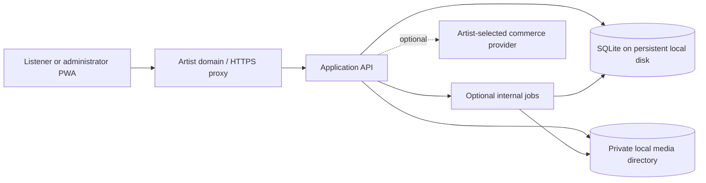

# Architecture proposal

Status: reference architecture and renewable-allowance metering direction accepted. The first installation/authentication/player/PWA implementation exists; no credit deductions or reservations are implemented. Detailed metering protocol remains under investigation.

## Deployment model

Use one artist per independently operated instance. The artist owns DNS, TLS, infrastructure, branding, content, accounts, and provider configuration. No mandatory Musixene account, activation server, telemetry endpoint, licensing service, or runtime API is permitted. The attribution link must not gate operation or automatically contact Musixene.

The approved reference deployment is a container-based modular monolith: a same-origin PWA and application API, SQLite for transactional data, and private local filesystem media storage. Local accounts and artist-controlled configuration are required. HTTPS terminates at an artist-controlled reverse proxy. No separate database server, object-storage service, broker, or worker service is mandatory. PostgreSQL and S3-compatible object storage are optional future expansion paths, not initial dependencies.

Media delivery may use an authorized gateway or scoped storage grants. The diagram does not imply public storage.

## Approved baseline and remaining decisions

| Area | Approved baseline | Tradeoff / remaining review |
| --- | --- | --- |
| Scope and structure | Independent single-artist instances; modular monolith | Multi-artist hosting and distributed services are outside the reference scope. |
| Database | SQLite with reliable transactional operations | One application host, persistent local disk, short writes, foreign keys, explicit durability, bounded busy handling, and tested backups. PostgreSQL is a future option when measured contention or multi-host needs justify it. |
| Storage | Private local filesystem outside the public web root | Persist separately from container images; validate paths and permissions. A narrow storage interface and stable IDs allow optional object storage later. |
| Deployment | Container-based reference deployment | Operators control TLS, persistent volumes, upgrades, and recovery. Exact runtime/framework and resource targets remain to be selected. |
| Streaming | Authenticated HTTP byte ranges | Delivery/preloading does not establish playback time. Tight buffer control is difficult; do not bill by bytes or requests. |
| Accounts/configuration | Local accounts and artist-controlled settings | Operator administrator bootstrap/recovery, invite-only signup and saved registration/branding settings are implemented; optional email remains outside this phase. |
| Credits | Proportional per-minute metered consumption, including zero/fractional rates | Renewable allowances with incremental reconciliation accepted for investigation; detailed measurement/settlement protocol remains unresolved. No fixed session fee. |
| Mobile | PWA using standard audio and Media Session APIs | Real-device feasibility and supported versions remain to be validated. |
| License | CPAL 1.0 adopted | The project LICENSE specifies required attribution and source availability; license compatibility and release compliance need continued review. |

SQLite is appropriate for transactional accounting when each reservation, settlement, and idempotency update commits atomically. Keep its database and journal files on supported local storage, not a shared network filesystem. Select and test journal/durability settings; never trade away financial durability for analytics throughput. Batch analytics separately. Avoid implementing two database backends prematurely; use versioned schema/export contracts and test migration when an expansion backend is introduced.

## Private playback and mobile behavior

Authorize each session against account access, content availability, rate, and balance. Issue short-lived content-scoped grants bound to that session; recheck on renewal. Support seeking/range retries without charging for each request. Prefer same-origin secure cookies. Signed URLs, if selected, must be short-lived and excluded from logs, analytics, and referrers. Define the revocation window: expired grants or an active gateway check stop future delivery, but cannot retrieve bytes already delivered. Authenticated streaming is not DRM or prevention of recording.

Cache only the application shell and public branding in the service worker. Do not cache private audio, tokens, balances, feedback, or authenticated API responses. Offline audio is outside initial scope.

Use standard audio playback and Media Session handlers where supported. Verify Android and iOS installation, screen lock, app switching, interruptions, seeking, and Bluetooth controls on real devices. A service worker cannot keep audio alive indefinitely. Publish tested versions, limitations, and browser playback fallbacks rather than promising uniform behavior.

## Metered credits and commerce — design unresolved

The approved business requirement is consumption proportional to actual playback duration at each content item's artist-configurable credits-per-minute rate. Rates may be zero or fractional; public releases may cost 1/20 of an exclusive item's rate. Paused, buffering, and skipped time must not be billed. Replayed audio consumes credits again for its actual playback duration. A playback session is an accounting identity, not a fixed-charge unit.

[Metering approaches and recommendation](credit-metering-review.md) evaluates reservations, incremental consumption, reconciliation, event loss, mobile suspension, and auditability. Renewable playback allowances with incremental reconciliation are accepted for further investigation. Detailed protocol parameters remain proposals; no deductions are implemented. Accounting-related browser suspension must not unnecessarily interrupt background audio. In particular, duration measurement, uncertain intervals, reservation expiry, rounding, and settlement policy require approval before credit implementation.

Begin with audited manual credit grants and adjustments. Optional commerce adapters later translate verified provider events into idempotent grants and reversals. Verify webhook signatures and reconcile refunds/chargebacks. Do not store card details. Artists own provider accounts, taxes, and business decisions; no payment provider is mandatory.

## Data, privacy, and security

Model accounts/roles, artist settings, media, content, ordered collections, rate versions, playback sessions, ledger entries, likes, private feedback, and audit events. Separate product analytics from billing evidence. Report delivery activity separately from client-reported playback estimates and accepted metering evidence; none proves human attention.

Feedback is visible only to its author and authorized artist administrators. Likes and listener activity are private by default. Feedback uses schema-3 tables with caller-only access, private paginated administrator review, and explicit deletion/export controls; see [privacy policy](privacy.md). Define analytics events and their separate retention/export policy before analytics implementation. Ledger integrity may require pseudonymization rather than deleting transaction history; review applicable obligations. No third-party tracking by default.

Require TLS, secure HttpOnly sessions, CSRF protection, password hashing, role/object authorization, rate limits, upload validation, size/format limits, isolated media processing, redacted logs, and dependency updates. Define account recovery and session invalidation. Never place secrets in source, client bundles, routine exports, or logs.

## Portability and operation

Provide versioned migrations, machine-readable metadata exports, stable identifiers, media manifests, and media export procedures. Include settings, collection order, rates, ledger, likes, and feedback under appropriate permissions. Distinguish listener exports from full instance migration. Password hashes and operational secrets are sensitive backup material, not routine exports.

Use SQLite-supported backup procedures or stop the application for a consistent database copy; do not blindly copy a live database while ignoring its journal. Back up database and media consistently, encrypt backups, keep secrets separately, and restore into a fresh isolated instance. Record schema/application versions and document upgrade prerequisites and rollback limits. Some migrations may require restoring a pre-upgrade backup. Exports alone do not demonstrate recoverability.

## Review gate

The deployment baseline above is approved. Remaining decisions are framework/runtime selection, metering protocol and uncertainty policy, platform support matrix, authentication/recovery, privacy/retention/export policy, and license/attribution requirements. Record accepted choices as architectural decision records. The installation, authentication, player, and PWA phase is authorized and implemented. Credit deductions and production access are not authorized.

## First functional implementation

Node.js 24 LTS supplies the HTTP server, scrypt cryptography, and built-in SQLite. Plain browser modules avoid a frontend build pipeline. `apps/server` owns authentication/catalog/private range delivery; `apps/web` owns the persistent audio element, queue, Media Session handlers, and public-shell service worker. `packages/domain/accounting.js` defines a replaceable playback-authorization boundary whose current implementation always allows authenticated playback without charge or browser renewal. Operator scripts generate synthetic audio, import trusted tracks, and create/reset listeners. Framework/runtime selection for this phase is Node 24 with no production npm dependencies.

API: public `GET /api/health` and `/api/config`; origin-checked `POST /api/register` and `/api/login`; authenticated `GET /api/me`, `/api/tracks`, `/api/tracks/:id/audio`; origin/CSRF-checked `POST /api/logout`. Audio supports GET/HEAD and single byte ranges. Sessions last 30 days and are revoked by logout/reset. There is no credit/analytics submission endpoint. See [operations](operations/running.md) and [validation](validation.md) for limitations and test evidence.

## Player/catalog architecture (schema 4)

The browser keeps displayed catalog IDs separate from an explicitly selected queue snapshot and active-track ID. One audio element lives outside Player/Store panels. Active feedback reuses existing server APIs and retains track-bound drafts only in signed-in memory; dialogs cannot silently retarget an old draft. The persistent footer is outside the independently scrolling catalog/main areas.

`catalog.js` applies bounded equality/any-of rules to listener-visible records; curated catalog order still comes from collection_tracks. Release designation never grants access. Metadata arrays are validated/bounded and stored as JSON; extensible content type is plain validated text. `branding.js` validates bounded static PNGs and serves only configured asset names. Public branding, manifests and themes bypass the shell cache; private media/artwork/API responses remain uncached. No external infrastructure or production npm dependency was added. See [behavior and upgrade semantics](player-redesign.md).
