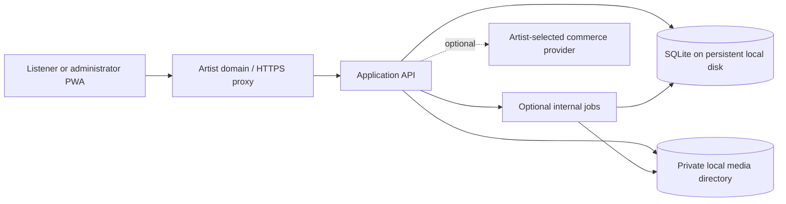

# Architecture proposal

Status: reference architecture and renewable-allowance metering direction accepted. The first installation/authentication/player/PWA implementation exists; no credit deductions or reservations are implemented. Detailed metering protocol remains under investigation.

## Deployment model

Use one artist per independently operated instance. The artist owns DNS, TLS, infrastructure, branding, content, accounts, and provider configuration. No mandatory Musixene account, activation server, telemetry endpoint, licensing service, or runtime API is permitted. The attribution link must not gate operation or automatically contact Musixene.

The approved reference deployment is a container-based modular monolith: a same-origin PWA and application API, SQLite for transactional data, and private local filesystem media storage. Local accounts and artist-controlled configuration are required. HTTPS terminates at an artist-controlled reverse proxy. No separate database server, object-storage service, broker, or worker service is mandatory. PostgreSQL and S3-compatible object storage are optional future expansion paths, not initial dependencies.

Media delivery may use an authorized gateway or scoped storage grants. The diagram does not imply public storage.

## Approved baseline and remaining decisions

| Area | Approved baseline | Tradeoff / remaining review |
| --- | --- | --- |
| Scope and structure | Independent single-artist instances; modular monolith | Multi-artist hosting and distributed services are outside the reference scope. |
| Database | SQLite with reliable transactional operations | One application host, persistent local disk, short writes, foreign keys, explicit durability, bounded busy handling, and tested backups. PostgreSQL is a future option when measured contention or multi-host needs justify it. |
| Storage | Private local filesystem outside the public web root | Persist separately from container images; validate paths and permissions. A narrow storage interface and stable IDs allow optional object storage later. |
| Deployment | Container-based reference deployment | Operators control TLS, persistent volumes, upgrades, and recovery. Exact runtime/framework and resource targets remain to be selected. |
| Streaming | Authenticated HTTP byte ranges | Delivery/preloading does not establish playback time. Tight buffer control is difficult; do not bill by bytes or requests. |
| Accounts/configuration | Local accounts and artist-controlled settings | Operator administrator bootstrap/recovery, invite-only signup and saved registration/branding settings are implemented; optional email remains outside this phase. |
| Credits | Proportional per-minute metered consumption, including zero/fractional rates | Renewable allowances with incremental reconciliation accepted for investigation; detailed measurement/settlement protocol remains unresolved. No fixed session fee. |
| Mobile | PWA using standard audio and Media Session APIs | Real-device feasibility and supported versions remain to be validated. |
| License | CPAL 1.0 adopted | The project LICENSE specifies required attribution and source availability; license compatibility and release compliance need continued review. |

SQLite is appropriate for transactional accounting when each reservation, settlement, and idempotency update commits atomically. Keep its database and journal files on supported local storage, not a shared network filesystem. Select and test journal/durability settings; never trade away financial durability for analytics throughput. Batch analytics separately. Avoid implementing two database backends prematurely; use versioned schema/export contracts and test migration when an expansion backend is introduced.

## Private playback and mobile behavior

Authorize each session against account access, content availability, rate, and balance. Issue short-lived content-scoped grants bound to that session; recheck on renewal. Support seeking/range retries without charging for each request. Prefer same-origin secure cookies. Signed URLs, if selected, must be short-lived and excluded from logs, analytics, and referrers. Define the revocation window: expired grants or an active gateway check stop future delivery, but cannot retrieve bytes already delivered. Authenticated streaming is not DRM or prevention of recording.

Cache only the application shell and public branding in the service worker. Do not cache private audio, tokens, balances, feedback, or authenticated API responses. Offline audio is outside initial scope.

Use standard audio playback and Media Session handlers where supported. Verify Android and iOS installation, screen lock, app switching, interruptions, seeking, and Bluetooth controls on real devices. A service worker cannot keep audio alive indefinitely. Publish tested versions, limitations, and browser playback fallbacks rather than promising uniform behavior.

## Metered credits and commerce — design unresolved

The approved business requirement is consumption proportional to actual playback duration at each content item's artist-configurable credits-per-minute rate. Rates may be zero or fractional; public releases may cost 1/20 of an exclusive item's rate. Paused, buffering, and skipped time must not be billed. Replayed audio consumes credits again for its actual playback duration. A playback session is an accounting identity, not a fixed-charge unit.

[Metering approaches and recommendation](credit-metering-review.md) evaluates reservations, incremental consumption, reconciliation, event loss, mobile suspension, and auditability. Renewable playback allowances with incremental reconciliation are accepted for further investigation. Detailed protocol parameters remain proposals; no deductions are implemented. Accounting-related browser suspension must not unnecessarily interrupt background audio. In particular, duration measurement, uncertain intervals, reservation expiry, rounding, and settlement policy require approval before credit implementation.

Begin with audited manual credit grants and adjustments. Optional commerce adapters later translate verified provider events into idempotent grants and reversals. Verify webhook signatures and reconcile refunds/chargebacks. Do not store card details. Artists own provider accounts, taxes, and business decisions; no payment provider is mandatory.

## Data, privacy, and security

Model accounts/roles, artist settings, media, content, ordered collections, rate versions, playback sessions, ledger entries, likes, private feedback, and audit events. Separate product analytics from billing evidence. Report delivery activity separately from client-reported playback estimates and accepted metering evidence; none proves human attention.

Feedback is visible only to its author and authorized artist administrators. Likes and listener activity are private by default. Feedback uses schema-3 tables with caller-only access, private paginated administrator review, and explicit deletion/export controls; see [privacy policy](privacy.md). Define analytics events and their separate retention/export policy before analytics implementation. Ledger integrity may require pseudonymization rather than deleting transaction history; review applicable obligations. No third-party tracking by default.

Require TLS, secure HttpOnly sessions, CSRF protection, password hashing, role/object authorization, rate limits, upload validation, size/format limits, isolated media processing, redacted logs, and dependency updates. Define account recovery and session invalidation. Never place secrets in source, client bundles, routine exports, or logs.

## Portability and operation

Provide versioned migrations, machine-readable metadata exports, stable identifiers, media manifests, and media export procedures. Include settings, collection order, rates, ledger, likes, and feedback under appropriate permissions. Distinguish listener exports from full instance migration. Password hashes and operational secrets are sensitive backup material, not routine exports.

Use SQLite-supported backup procedures or stop the application for a consistent database copy; do not blindly copy a live database while ignoring its journal. Back up database and media consistently, encrypt backups, keep secrets separately, and restore into a fresh isolated instance. Record schema/application versions and document upgrade prerequisites and rollback limits. Some migrations may require restoring a pre-upgrade backup. Exports alone do not demonstrate recoverability.

## Review gate

The deployment baseline above is approved. Remaining decisions are framework/runtime selection, metering protocol and uncertainty policy, platform support matrix, authentication/recovery, privacy/retention/export policy, and license/attribution requirements. Record accepted choices as architectural decision records. The installation, authentication, player, and PWA phase is authorized and implemented. Credit deductions and production access are not authorized.

## First functional implementation

Node.js 24 LTS supplies the HTTP server, scrypt cryptography, and built-in SQLite. Plain browser modules avoid a frontend build pipeline. `apps/server` owns authentication/catalog/private range delivery; `apps/web` owns the persistent audio element, queue, Media Session handlers, and public-shell service worker. `packages/domain/accounting.js` defines a replaceable playback-authorization boundary whose current implementation always allows authenticated playback without charge or browser renewal. Operator scripts generate synthetic audio, import trusted tracks, and create/reset listeners. Framework/runtime selection for this phase is Node 24 with no production npm dependencies.

API: public `GET /api/health` and `/api/config`; origin-checked `POST /api/register` and `/api/login`; authenticated `GET /api/me`, `/api/tracks`, `/api/tracks/:id/audio`; origin/CSRF-checked `POST /api/logout`. Audio supports GET/HEAD and single byte ranges. Sessions last 30 days and are revoked by logout/reset. There is no credit/analytics submission endpoint. See [operations](operations/running.md) and [validation](validation.md) for limitations and test evidence.

## Player/catalog architecture (schema 4)

The browser keeps displayed catalog IDs separate from an explicitly selected queue snapshot and active-track ID. One audio element lives outside Player/Store panels. Active feedback reuses existing server APIs and retains track-bound drafts only in signed-in memory; dialogs cannot silently retarget an old draft. The persistent footer is outside the independently scrolling catalog/main areas.

`catalog.js` applies bounded equality/any-of rules to listener-visible records; curated catalog order still comes from collection_tracks. Release designation never grants access. Metadata arrays are validated/bounded and stored as JSON; extensible content type is plain validated text. `branding.js` validates bounded static PNGs and serves only configured asset names. Public branding, manifests and themes bypass the shell cache; private media/artwork/API responses remain uncached. No external infrastructure or production npm dependency was added. See [behavior and upgrade semantics](player-redesign.md).

## Session-bound diagnostics (0.3)

Diagnostics use the existing process, SQLite, administrator authentication, Origin checks and CSRF checks. Three gates are required: `DIAGNOSTICS_ALLOWED=true` (default false), saved instance enablement (default false), and an administrator explicitly selecting Start Debug. Enablement alone never records. Ordinary listeners cannot use diagnostic endpoints. Diagnostic settings and session markers are excluded from public configuration.

Schema 5 adds three private tables and diagnostic-prefixed settings. `diagnostic_sessions` associates a random, non-authorizing context marker with an existing session. `diagnostic_recordings` registers a recording ID, original session, owner, policy generation and start time; registration is a control request containing no events. `diagnostic_reports` stores bounded canonical JSON and metadata directly in SQLite. No media or existing account/session/catalog columns are rewritten. Existing password hashes, roles, invitations, feedback, visibility, branding, files and ordered memberships are preserved. Failed migration 5 rolls back atomically; startup is repeatable. Newer schemas remain rejected by older binaries.

IndexedDB holds one bounded recording per browser origin. Its binding includes installation, administrator, original session context, tab identifier and recording ID. Session markers are identifiers, never credentials; CSRF remains in memory and never enters the report. The same tab resumes across administration/player navigation and reload after server validation. A second tab cannot overwrite a recording held by the first. Another authenticated session, including a fresh login as the same administrator, clears old private local data instead of resuming it. BroadcastChannel signals contain no report content. Writes compare the stored binding, so a stale page cannot restore a cleared or replaced recording. Browser storage failure cannot propagate into the audio handlers.

Events are projected through a field allowlist. They contain track UUIDs and audio/queue state, not titles, note contents, passwords, cookies, request bodies, authorization headers or URLs. Native playback and Media Session error names and sanitized messages remain useful; unrestricted global exception text/stacks are omitted. Reports use format version 1; event names and categories are stable. Browser/OS information is coarse, without a complete user-agent string. See `tests/fixtures/diagnostic-report.example.json` for **synthetic illustrative data, not physical-device evidence**.

There are no periodic event uploads. Events are batched locally at task boundaries, coalescing writes to one in-flight snapshot and the latest bounded state; no timeupdate flood, wake lock, keepalive, audio worker or diagnostic background timer is added. Selective native events and at most one position sample per 30 seconds of observed time are recorded. Local event storage is capped at 4,000 events and approximately 1 MiB (up to approximately 2 MiB including finalization metadata/snapshot), dropping oldest events with a counter. Report schema validation and byte limits independently enforce these bounds at upload. Recording and registration expire after 24 hours. Navigation can lose the last uncommitted events if the browser kills the page. The recorder reports observable time gaps; gaps do not prove which operations occurred during JavaScript suspension.

Stop Debug freezes collection, adds `recording-stopped`, saves a finalized snapshot and uploads one report using the current existing session. An acknowledgment clears the local snapshot. An interrupted or failed upload remains finalized in the same session; retries reuse exactly the same report. Identical duplicates return the existing acknowledgment, conflicting duplicates fail, and deleted reports cannot be recreated from a completed receipt. No automatic retry, session extension, diagnostic bearer token, post-logout upload or reauthentication reconciliation exists.

Logout records initiation and completes that upload before issuing the existing logout request. An eight-second upload timeout opens Retry, Export and Continue, explicit Discard and Continue, or Cancel controls. Local storage operations also have bounded timeouts. Continuing clears local data; an unavailable database cannot be opened under a new session binding. The report intentionally does not include the result of the final logout request. Logout without a local recording uses the normal request without diagnostic network requests or prompts. A same-session recording in another tab may be finalized from its latest persisted snapshot during logout; ordinary recording controls remain in the originating tab.

Permission is revalidated at initialization, foreground restoration and reconnect. A remote policy change cannot immediately stop an offline or suspended device. Once observed, collection stops; the old policy generation cannot upload even if enablement is later restored. Expired/disabled/non-administrator sessions cannot access diagnostic endpoints. Previously saved reports remain accessible only to their owner, even when recording is prohibited. Each report retrieval/export/deletion checks ownership; there are no public report files or service-worker-cached reports.

Default retention is seven days, configurable from one to thirty days by an administrator. Retention applies instance-wide and is enforced at startup, diagnostic requests, settings changes and hourly server cleanup. Quotas are twenty retained reports per administrator and one hundred per installation; reaching a quota rejects new uploads without silently deleting another administrator's data. Registration receipts are limited to fifty per administrator and one thousand per installation in a 24-hour window. SQLite deleted pages are reused rather than securely erased; backups and manually exported files remain the operator's responsibility. No diagnostic data is automatically sent to Musixene, GitHub, or any external service.

The Android investigation instruments the existing `activate` → metadata/UI → `play` order without reordering it. Ended reception, queue selection, source assignment, activation completion, play promise results, audio events, lifecycle restoration and Media Session callbacks/errors can establish where a transition stops. No proposed playback workaround is claimed as a fix.

## Phase 2 media resource evidence (0.3.1)

The HTTP media route, range parser, authentication, queue, source assignment and play/pause/seek order are unchanged. Listener catalog metadata additionally includes the already-stored media MIME type. The new browser-only `media-diagnostics.js` observes media loading under the existing three gates. No server request logging, production log configuration, automatic retry, preload, `load()`, additional audio element, wake lock or service-worker media interception is added.

A Resource PerformanceObserver is attached only to an authorized active recording. It observes newly delivered entries without altering the browser's timing buffer. Only same-origin `/api/tracks/{UUID}/audio` paths survive; URLs with credentials, unrelated paths, external origins, query parameters and fragments are never retained. Each delivered resource entry is independent, including multiple requests for the same track. A bounded 64-entry local tail and up to eight entries per snapshot aid correlation. On failure or canplay/metadata events the recorder may also inspect the existing last 128 resource entries; this performs no network request. Observer failure or missing APIs falls back to available snapshots or explicitly unavailable evidence.

Resource entries retain supported request/response times relative to `performance.timeOrigin`, byte sizes, initiator type, protocol and `responseStatus`. Missing responseStatus becomes `statusAvailability: unavailable`; an exposed zero becomes `zero`. Both produce **inconclusive** HTTP evidence. A completed entry can be delivered after the audio error; a missing entry does not establish that a request was never attempted or never reached the server. Sizes of zero do not prove a transfer failed. `decodedBodySize` concerns HTTP content decoding, not successful audio decoding; it does not prove the recording is playable. `canPlayType` is only a format-support hint, not validation of the individual file. Resource Timing cannot expose request Range, response headers, response bytes, every redirect/upstream hop, proxy origin or client receipt of the complete body. An exposed status describes the browser-observed resource response, not necessarily Node’s original response before redirects/proxy processing. It may aggregate, omit or report only some media range operations depending on the browser.

Native error and rejected-play events include sanitized media snapshots: current active/requested IDs and paths, actual currentSrc reduced to an allowed path or a redacted/empty classification, MIME and `canPlayType` hint, ready/network states, paused/ended/position/duration, up to eight buffered/seekable ranges, media/play errors, visibility/online state, time since visible, Media Session state and recent timings. Unknown/infinite duration is null. Document UUID plus source-generation/play-operation counters and performance times distinguish overlapping operations. A rejected promise retains the original requested track/MIME while snapshotting the currently active source; `sourceChangedSinceRequest` and `playChangedSinceRequest` explicitly mark overlap. Counters describe observed operations, not proof that an asynchronous browser request belongs exclusively to one transition.

**Test Failed Media Source** is a manual action, available in Diagnostics and the player account menu only during an authorized active recording with a known failed track and visible document. Permission must be freshly revalidated before the request; a failed control request cannot authorize the probe using cached offline permission. It uses existing same-origin authentication and `GET` with `Range: bytes=0-0`, no-store and no redirect following. It captures only sanitized status/response headers and header latency (headerStates distinguishes missing headers from captured or malformed/redacted values), then aborts/cancels the response without ever reading, decoding or retaining its body. If a proxy ignores Range and sends 200, cancellation at headers bounds application consumption; the browser may already have received buffered bytes. No client can guarantee exactly one byte on the wire against a noncompliant server. The eight-second deadline, visibility changes, stopped recording or cleared session cancel an in-flight probe. A probe is never scheduled on failure, foreground restoration or unlock. Complete it before Stop Debug or logout; finalized reports remain immutable.

Probe timing entries are marked `purpose: subsequent_foreground_probe`; unrecognized script fetches are `unclassified`. These never become original-media evidence. A successful foreground probe establishes only what that **subsequent** request returned. It does not establish what the failed background request returned.

### Report format 2

The canonical export contract is [diagnostic-report-v2.schema.json](diagnostic-report-v2.schema.json). The shared browser/server validator remains authoritative for size, sequential event order and timing bounds. Format 2 retains format 1's envelope and event fields and adds optional `resource`, `media` and `probe` structures plus server-recomputed `mediaAnalysis`. Unknown nested fields are projected out, and arbitrary event fields remain rejected. Existing format-1 reports, frozen retries, ownership, idempotency, bounded IndexedDB, retention, quotas, logout and single completed-report upload remain supported. SQLite stays **schema 5**; there is no database migration. An existing unfrozen recording can export format 2 after loading new code; a frozen format-1 report remains exactly frozen. Prefer a fresh recording on 0.3.1 for a clean investigation.

`mediaAnalysis` contains up to 32 failure summaries and 32 candidate IDs per summary (omission counts retain the truncation context). The recorder reserves 192 KiB of the 1 MiB report cap for bounded analysis/metadata rather than filling the entire cap with raw events. Summaries use same-document, same-track, known source-generation/time-window **candidate** original-media observations. It never treats a later probe, another generation/document or missing/zero status as original HTTP success/failure. Several observed statuses can yield several candidate cases. Near-identical timing observations may be deduplicated in this summary; raw independent resource events remain in the report, so summary counts are not wire request counts. `conclusiveCause` is always false: even a captured HTTP error does not establish the reason it happened.

| Case | Original candidate status | What to investigate next |
| --- | --- | --- |
| A | 401 / 403 | Original session, cookies, authorization and proxy behavior; no automatic authentication change |
| B | 404 / 500 / other unexpected status | Routing, file availability, storage and server/upstream errors |
| C | 416 | Actual request Range and response Content-Range/length; existing parser and proxy behavior |
| D | 200 / 206 with media failure | Actual headers, MIME/container/bytes, content encoding/integrity and Chrome initialization; not proof of an unsupported codec |
| E | No positively exposed original status | Missing/zero client data is inconclusive; check retained server/proxy evidence |

The sanitized [HTTP failure sample](../tests/fixtures/media-http-failure.example.json) is **synthetic**, not the operator's captured phone report. Physical locked Android validation is outstanding. No playback remedy is proposed as established.

### Remaining server evidence gap; separate approval required

If existing logs and Resource Timing still cannot establish the original response, a separate proposal is a disabled-by-default, operator-permitted and administrator-started **original media request trace**, restricted to that administrator's original session, a short explicit trace window and optional track IDs. It would capture bounded request IDs, UTC time, sanitized Range, application response status/type/length/range/encoding, stream errors and finish/close state in private owner-access-controlled storage, with short retention and request/byte quotas. It must not retain cookies, authentication hashes/headers, client IP, arbitrary URLs, bodies or listener activity. Trace start/stop and expiry must be explicit; local browser recording alone must not authorize indefinite tracing. A response finish means Node handed data onward, not proof that Chrome received/decoded it; proxy-originated responses still require proxy evidence. This is a proposal only—**no server tracing or Nginx logging change is implemented or authorized in this PR**.

## Early-playback ordering experiment (0.3.2)

This deliberately small experiment supersedes the original activation order retained in 0.3.0/0.3.1. For an activation with autoplay enabled, the existing queue/active track is selected, the source is assigned (or the same-source repeat position reset), and the existing `play()` helper is invoked immediately, before position display, note-dialog changes, artwork, Like/Note controls and Media Session metadata updates. The play promise is not awaited by activation: the interface still updates while playback is pending or later rejects. Exactly one play request is made; startup `autoplay: false` does not request playback. The existing diagnostic source events remain before `play-requested`; `metadata-update-started` and `activation-completed` now follow it on autoplay activation. A presentation error after assignment can no longer prevent this initial play request, though the error is still reported.

One persistent audio element, source URLs, queue computation/order, shuffle, repeat modes, manual Next/Previous, seeking, feedback drafts, authentication, range delivery and diagnostic authorization/storage/upload remain unchanged. No retry, `load()`, prefetch, wake lock, keepalive, server tracing, additional network request or media element is introduced. SQLite remains schema 5 and reports remain format 2; there is no data migration. The public code shell cache advances to v7.

The operator's 0.3.1 report showed that play was reached but a later background media load failed with zero exposed response/transfer timings and no matching proxy access entry; successful requests in the same report matched proxy statuses/byte counts. The operator also reports success with Chrome net-export active and failure returning after reinstall. These observations support investigating background/browser/network state but do not establish that logging kept Chrome awake; reinstallation also changes state. Earlier play invocation is a hypothesis, not a confirmed fix for a blocked network/media pipeline. No physical Android result for 0.3.2 is claimed.
