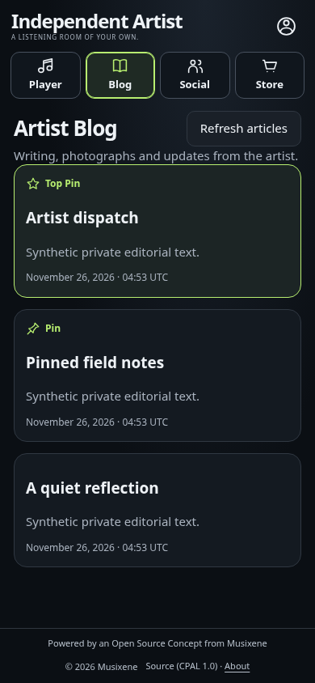
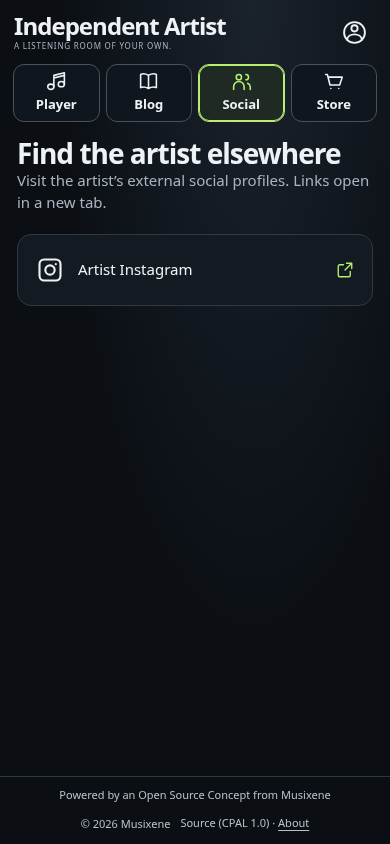
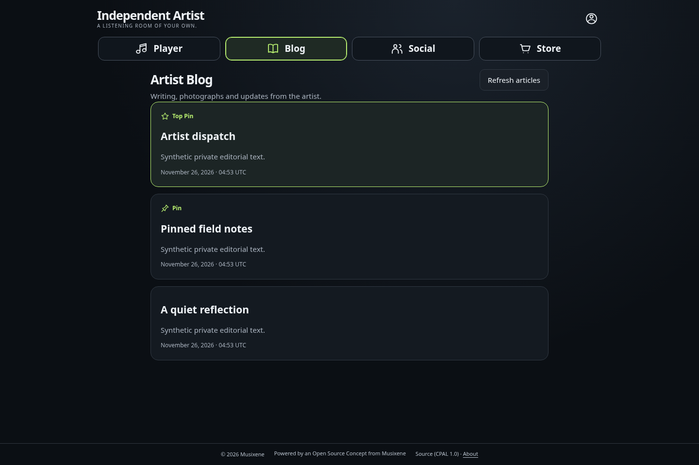
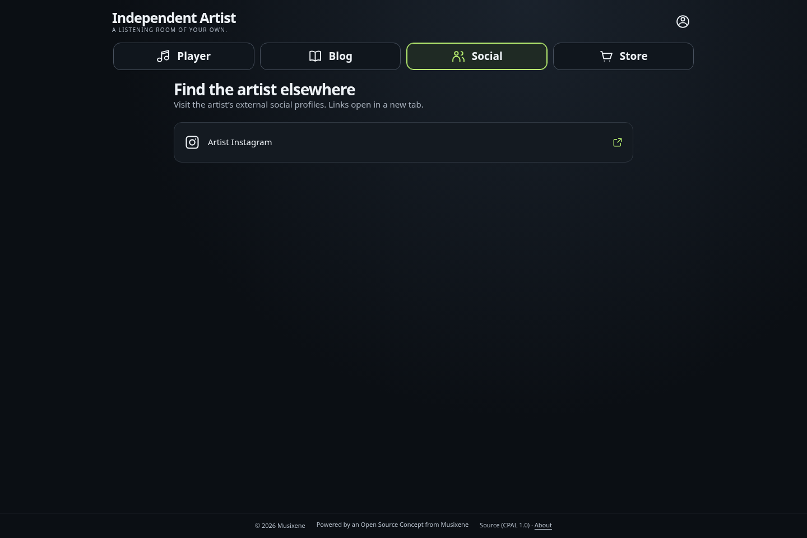
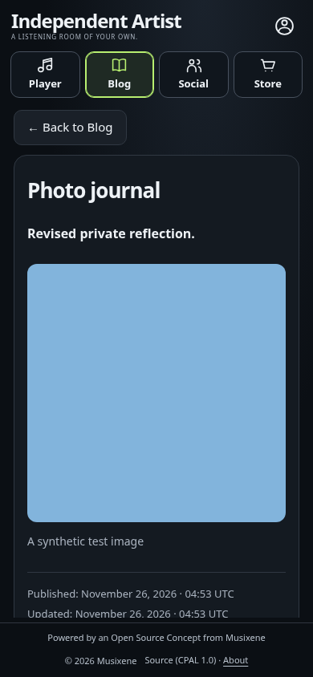
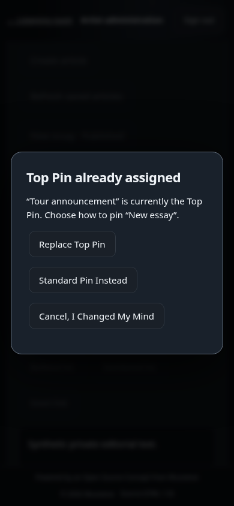
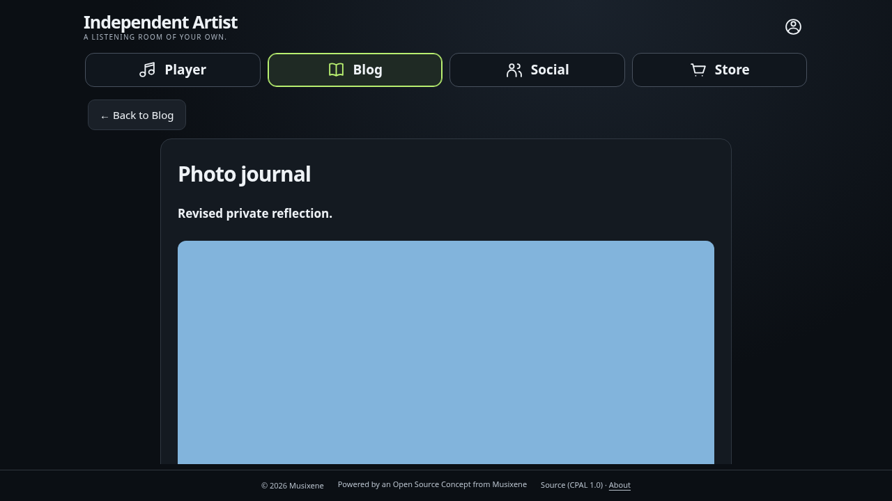
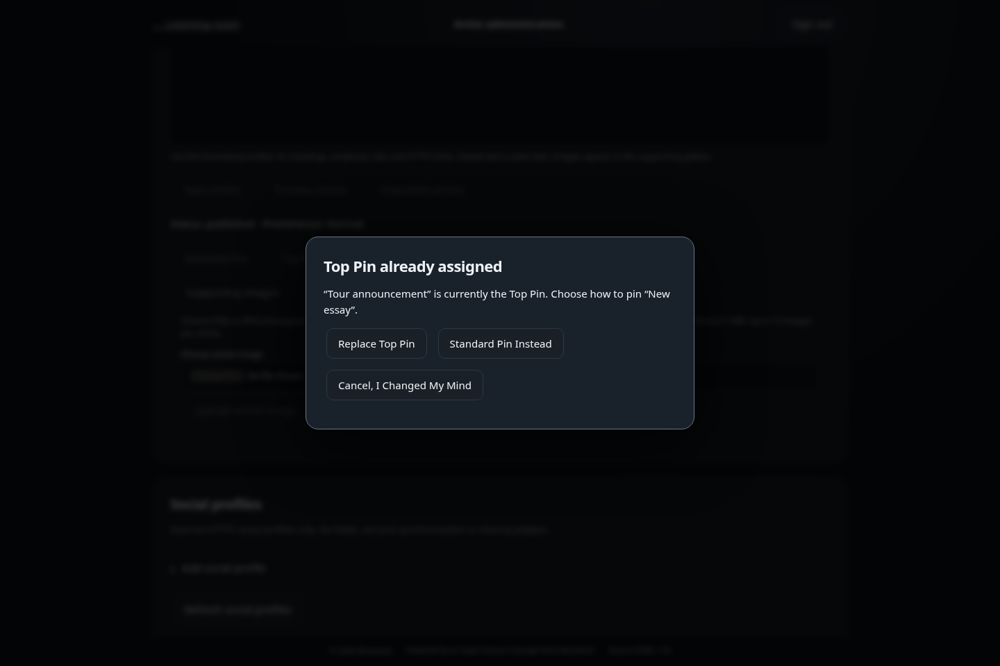

# Artist Blog and Social — 0.5 review guide

The milestone starts from main v0.4.0/schema 6. Version 0.5.0 adds schema 7 and four in-app sections in order: Player, Blog, Social, Store. Player remains default. The existing single audio element, queue, Media Session, Like/private-note controls, qualifying clock, credits/ledger, diagnostics and artist/PWA branding are preserved. Navigation hides views without changing the audio source, starting an engagement or manipulating credits. Music already playing can qualify while reading; opening an article itself produces no listening activity. Store content and functionality remain unchanged.

Artist writing and photographs remain separate artist-controlled material; storing them here does not automatically license them under the software’s CPAL license.

## Publishing workflow

Open Administration → Blog → Create article. Write a title and body. The formatting toolbar applies paragraphs, two heading levels, bold/italic, flat bulleted/numbered lists and HTTPS links. Paste is plain text, preserving the private environment without external embedded content. Save draft creates the durable article; Preview article uses the same reader renderer with an administrator-only draft notice. Preview saves pending edits first. An editor's unsaved changes prompt before changing articles or leaving the page.

Publish assigns server-generated UTC epoch milliseconds to Published and Updated in the same transaction. Draft creation time is never used for listener ordering or displayed to listeners. Editing content after first publication changes Updated, including edits while temporarily unpublished. Pin/status changes never change those timestamps. Unpublish hides the article and all its images from ordinary listeners; Republish preserves its original publication date. Editing a published article saves live changes; unpublish first if revisions should remain private. Concurrent stale revisions are rejected and unsaved editor text is retained. Reload saved article explicitly discards unsaved changes with confirmation.

Normal articles have no prominence icon. Standard Pins use a pin icon and appear above normals, newest original publication first. Top Pin uses a star and appears first. All categories use article ID descending for publication-time ties. Top Pin is restricted to published articles, with a partial unique database index. An unpublished Top Pin automatically becomes a standard Pin; it remains a standard Pin on republication, leaving any newer Top Pin untouched. Draft standard Pins can be prepared privately but do not appear in the Blog.

Assigning an unoccupied Top Pin is immediate; selecting the current Top Pin is a no-op. A conflict identifies the current article and offers exactly **Replace Top Pin**, **Standard Pin Instead**, and **Cancel, I Changed My Mind**. Replace demotes the prior Top Pin to standard Pin and promotes the candidate atomically. Standard Pin Instead leaves the occupant unchanged. Cancel/Escape changes neither article. Pin controls require saved content so Cancel cannot implicitly save unrelated edits. Expected occupant ID/revision and candidate revision are checked under an immediate transaction; a concurrent winner or content edit causes a conflict rather than a silent replacement. A failed promotion rolls back demotion of the previous Top Pin.

Delete article requires confirmation and removes its image metadata in the same transaction. Only that article's generated files under `editorial-images/` are subsequently removed; music, artwork, branding and backups are never cleanup targets. Interrupted cleanup can leave an inaccessible orphan file for operator reconciliation; it cannot become publicly served content.

## Images, content safety and private access

The editor accepts PNG/JPEG files up to 20 MiB and locally re-encodes/resizes them to PNGs at most 2048×2048 and 2 MiB. Supporting photos appear in an ordered gallery; the first photo is the optional list preview. Up to 12 images per article. The server independently validates PNG signatures, chunk structure/checksums, dimensions (minimum 32×32), static 8-bit RGB/RGBA encoding and bounded decompression, then writes an exclusive private file with mode 0600 and syncs it before committing metadata. Animated/interlaced/indexed PNG and raw JPEG uploads to the server are not supported; the UI converts ordinary JPEG photographs locally. Extremely tall/narrow or undecodable images may require resizing first. Description, caption and numeric position are editable. Leave the description empty only for decorative images.

Article bodies are bounded structured JSON documents, not raw HTML: up to 500 blocks and 64,000 encoded bytes. The shared validator accepts only text, emphasis, headings, flat lists and HTTPS links. Rendering uses DOM text nodes and an explicit element allowlist; unsupported HTML, scripts, event attributes, embeds, inline images, audio/video and arbitrary attributes cannot enter the stored document format. Images are separate validated attachments. Titles, captions and labels render as inert text. Formatting uses the browser's editing commands; nested lists, arbitrary fonts/colors, tables, embeds and complex CMS/version-history features are intentionally absent.

All Blog, image and Social APIs require the existing authenticated session. Ordinary listeners see only published articles and enabled social links. Draft reading/editing/publishing/image management requires administrator authorization; writes retain origin/CSRF checks and post-body authorization revalidation. Private files are outside the web root and served only through authenticated APIs with no-store headers. The service worker caches public application modules only, never article JSON, Social responses or private images. Logout removes article/link DOM state; late responses cannot repopulate another session's view. Material already delivered to an authorized listener cannot be made technically uncopyable.

Lists load 12 metadata/excerpt entries per page without full bodies. Opening an article fetches its body within the PWA; there are no public article pages, slugs, article URL changes, copy-link/share controls, article Likes/comments/reactions or listener posts. Pin/publication changes during pagination can shift page boundaries; the reader deduplicates loaded IDs and Refresh articles restarts from page one.

## Social directory

Administration → Social supports label, HTTPS profile URL, platform icon/identity, numeric position, enabled state and confirmed removal. Links start disabled. Known local icons cover common platforms; Other/generic handles additional artist-selected profiles, and unrecognized persisted icon identities fall back to a generic link symbol. No accounts or destinations are hardcoded into installations.

URLs must be absolute HTTPS without credentials, backslashes or control/space characters; same-origin application URLs and dangerous schemes are rejected. There is no redirect endpoint or server-side retrieval. Links open directly in a new tab with noopener, noreferrer and no-referrer; no third-party scripts, avatars, feeds, APIs or authentication are loaded. External platforms govern what happens after the listener chooses to visit them. No Store links, commerce, redemption codes, purchases or payments were added to the deferred Store section.

## Schema and upgrade

Schema 7 adds only `articles`, `article_images`, `social_links` and indexes, including the unique Top Pin index and publication/timestamp checks. No existing columns/rows, balances, holds, ledger entries, diagnostic reports, settings or media files are changed. No seed articles or social profiles are installed. New images use a separate private directory. Startup is repeatable; a failed migration rolls back to schema 6. Old v0.4 code rejects schema 7, so code-only rollback is unsupported.

After PR review and explicit approval, deploy an exact approved merge SHA using [the stopped-container backup/deployment procedure](operations/administration.md#consistent-backup-and-deployment-compose). Back up the complete data volume, including SQLite/WAL, media, branding and editorial images, along with configuration, original revision and health output. No new `.env` variables or proxy routes are required. Existing upload limits must permit a 2 MiB PNG request; do not expose the image directory with an Nginx alias. Stop imports, publishing and other application writers during backup. Keep private copies off-host. No live artist deployment or the separate streaming installation is part of development validation.

### Rollback into a separate volume

Use only after deciding to roll back. This reference targets the original schema-6/v0.4 deployment and the saved Compose layout. Review any post-backup credit/accounting or editorial changes before restoring; retain the failed volume and archive so those changes can be reconciled. Never delete a production volume or overlay old SQLite files onto newer WAL/data.

From the same deployment directory with its normal APP_ORIGIN and Compose project, set `musixene_backup` to the verified pre-upgrade backup directory:

```bash
set -euo pipefail
: "${APP_ORIGIN:?Export the artist HTTPS origin}"
: "${musixene_backup:?Set the verified pre-upgrade backup directory}"
if ! git diff --quiet || ! git diff --cached --quiet; then
  echo "Review local tracked changes before continuing"
  exit 1
fi
sha256sum -c "$musixene_backup/data.tar.gz.sha256"
old_revision="$(cat "$musixene_backup/code-revision.txt")"
[[ "$old_revision" =~ ^[0-9a-f]{40}$ ]]
container_id="$(docker compose ps -aq artist)"
test -n "$container_id"
image_id="$(docker inspect --format '{{.Image}}' "$container_id")"
umask 077
docker compose stop artist
# Preserve the failed/newer data as well as its still-existing original volume.
docker cp "$container_id":/data/. - | gzip > "$musixene_backup/pre-rollback-data.tar.gz"
gzip -t "$musixene_backup/pre-rollback-data.tar.gz"
restore_volume="artist-restore-$(date -u +%Y%m%dT%H%M%SZ)"
if docker volume inspect "$restore_volume" >/dev/null 2>&1; then
  echo "Restore volume already exists; choose a new empty volume"
  exit 1
fi
docker volume create "$restore_volume"
# Only this newly created volume is populated; the failed volume remains intact.
docker run --rm -i --user 0 --entrypoint sh \
  --mount "type=volume,source=$restore_volume,target=/restore" "$image_id" \
  -c 'tar -C /restore -xzf - && chown -R 1000:1000 /restore && chmod 700 /restore' \
  < "$musixene_backup/data.tar.gz"
git switch --detach "$old_revision"
cp "$musixene_backup/compose.yaml" compose.yaml
cp "$musixene_backup/branding.json" branding.json
[ ! -f "$musixene_backup/.env" ] || cp "$musixene_backup/.env" .env
cat > "$musixene_backup/restore-volume.yaml" <<YAML
volumes:
  artist-data:
    external: true
    name: $restore_volume
YAML
docker compose -f compose.yaml -f "$musixene_backup/restore-volume.yaml" config -q
docker compose -f compose.yaml -f "$musixene_backup/restore-volume.yaml" \
  up -d --no-deps --build --wait --wait-timeout 120 artist
docker compose -f compose.yaml -f "$musixene_backup/restore-volume.yaml" \
  exec -T artist node -e 'fetch("http://127.0.0.1:3000/api/health").then(r=>r.json()).then(console.log)'
cat "$musixene_backup/health.json"
```

The health result must match the saved pre-upgrade version/schema (normally 0.4.0/schema 6). Verify login, catalog/media bytes, credit balances and audit state before resuming writes. Continue using the restore-volume override for subsequent Compose commands until intentionally adopting that restored volume; omitting it would point back to the retained failed volume. This is a rollback procedure, not an executed production action. Automated migration/restore tests use isolated synthetic storage; a complete operator-specific reverse-proxy/deployment rollback still requires the operator's controlled restore drill.

## Review screenshots

All images below are synthetic test states with generic artist identity, generated images and invented text/profiles, never production content. They illustrate browser layout, not physical Android/iOS testing.

| Blog | Social |
| --- | --- |
|  |  |
|  |  |

| Reader | Top Pin conflict |
| --- | --- |
|  |  |
|  |  |
